<div align="center">


# Motus

**A self-hosted fitness tracker for strength training, walks and runs.**
Log workouts, follow routines, watch your progress, and keep your data on your own device or server.

[](https://github.com/userofit123/motus/releases/latest)
[](https://github.com/userofit123/motus/actions/workflows/ci.yml)
[](LICENSE)

[Download](https://github.com/userofit123/motus/releases/latest) · [Install](#install) · [Screenshots](#screenshots) · [Self-hosting](docs/self-hosting.md) · [Changelog](CHANGELOG.md)

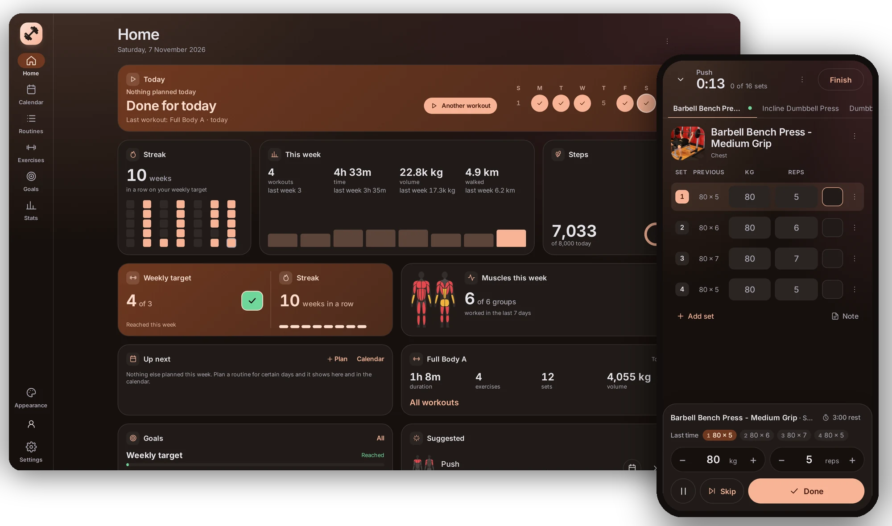

</div>

## What it does

- **Workouts:** start from a routine or from nothing. Last time's numbers are filled in, a rest timer runs between sets
  (also on the lock screen in the Android app), and the finish screen shows what improved.
- **Routines and programs:** build your own or start from templates (Push / Pull / Legs, Upper / Lower, Full body,
  bodyweight, stretching). Folders, schedules, version history and multi-week programs with deload weeks.
- **876 exercises** with photos, instructions and the muscles they work, plus your own exercises with photos or a video link.
- **Walks, runs and rides:** GPS recording with a map, splits and steps (keeps recording with the screen off on Android),
  manual entries, and GPX / TCX import and export.
- **Progress:** a calendar of everything you did, records and estimated one-rep maxes, charts per exercise, weekly sets
  per muscle, consistency, body weight with a smoothed trend, and goals with pace and history.
- **Your data stays yours:** use it fully offline on one device, or sync several devices through your own server.
  Backups (optionally encrypted), export to JSON / CSV, and import from Strong, Hevy and FitNotes.
- **Clean by default:** extras such as RPE, supersets, plate calculator, warm-up sets, body measurements, progress photos,
  achievements and more stay hidden until you switch them on in Settings → Features.
- **Make it look like you:** light or dark, 18 colour sets or your own, backgrounds, corners, density and fonts ([see them](#screenshots)).

## Screenshots

<table>
  <tr>
    <td width="50%">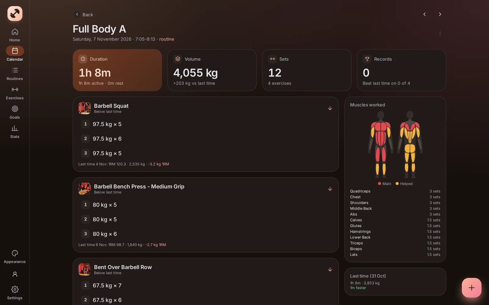<br><sub>A finished workout: sets, volume and muscles worked</sub></td>
    <td width="50%">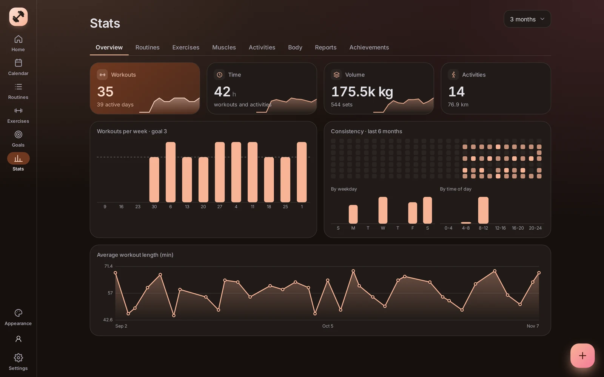<br><sub>Stats: workouts per week, consistency and workout length</sub></td>
  </tr>
  <tr>
    <td>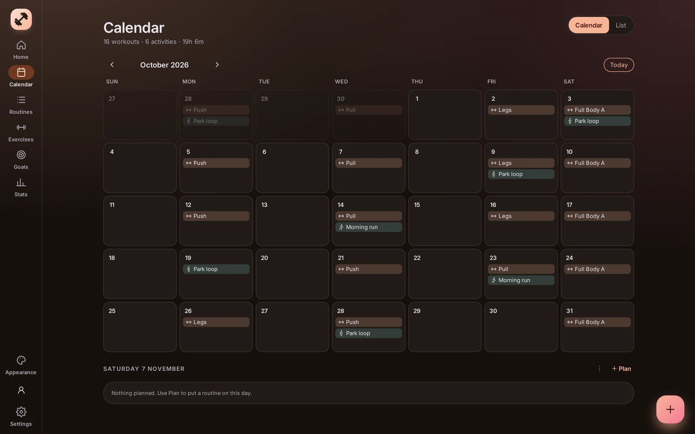<br><sub>Calendar of workouts and activities</sub></td>
    <td>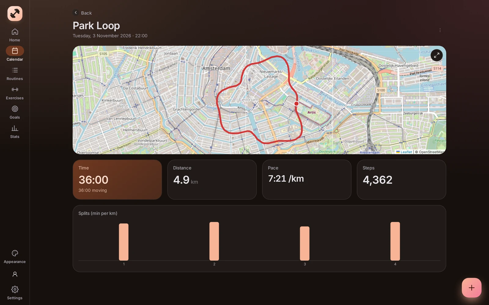<br><sub>A recorded walk with its route, pace and splits</sub></td>
  </tr>
  <tr>
    <td>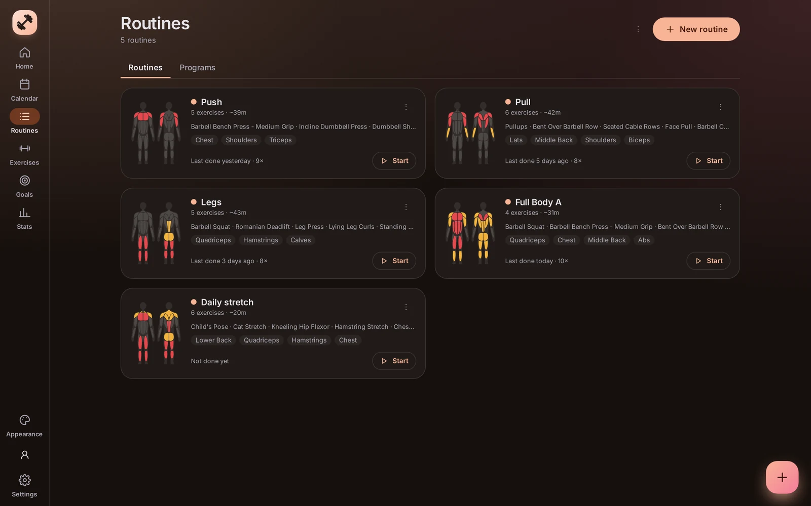<br><sub>Routines, each with the muscles it trains</sub></td>
    <td>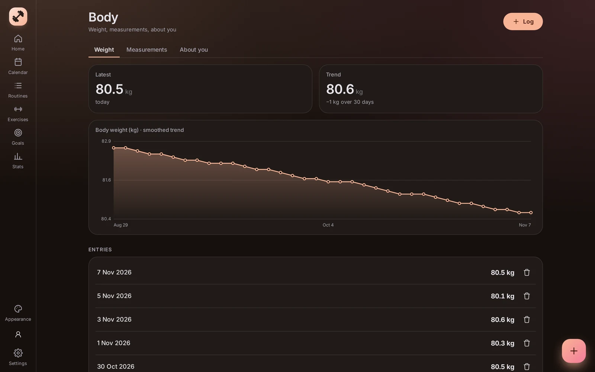<br><sub>Body weight with a smoothed trend</sub></td>
  </tr>
</table>

On the phone:

<p>
  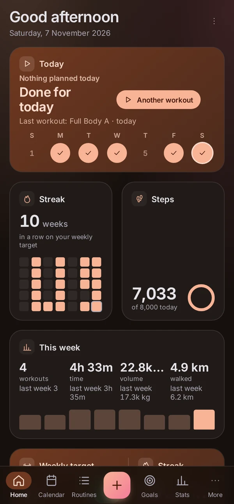
  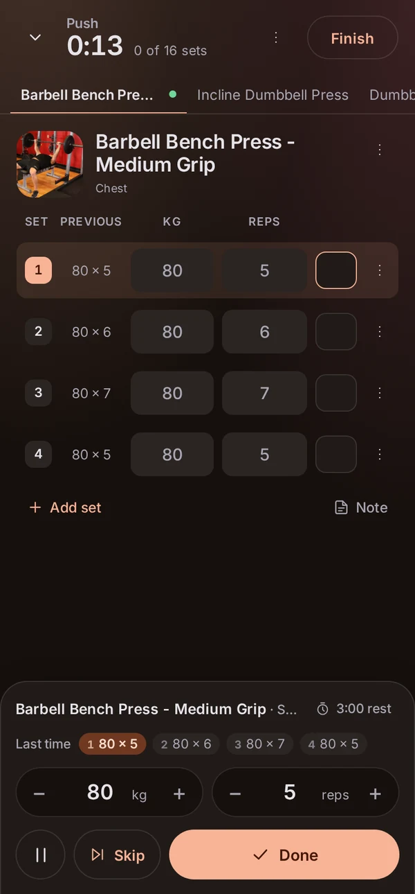
  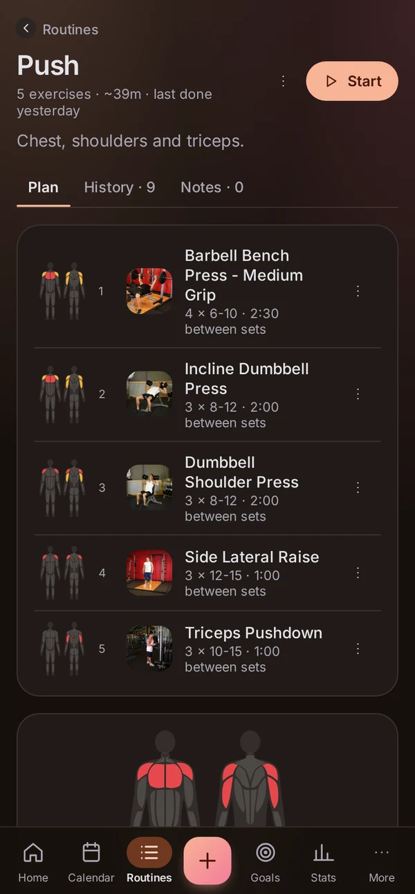
  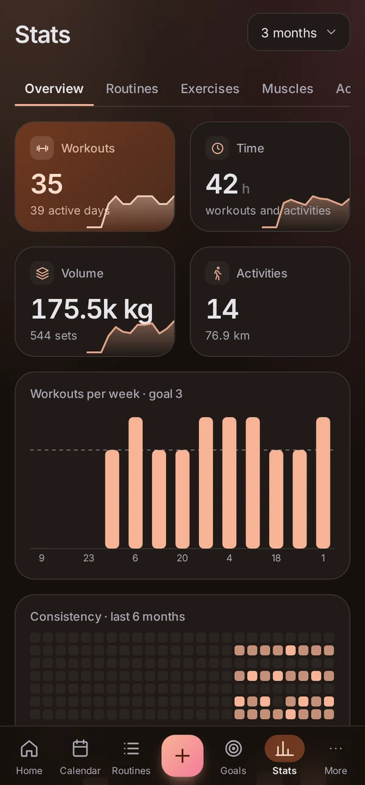
  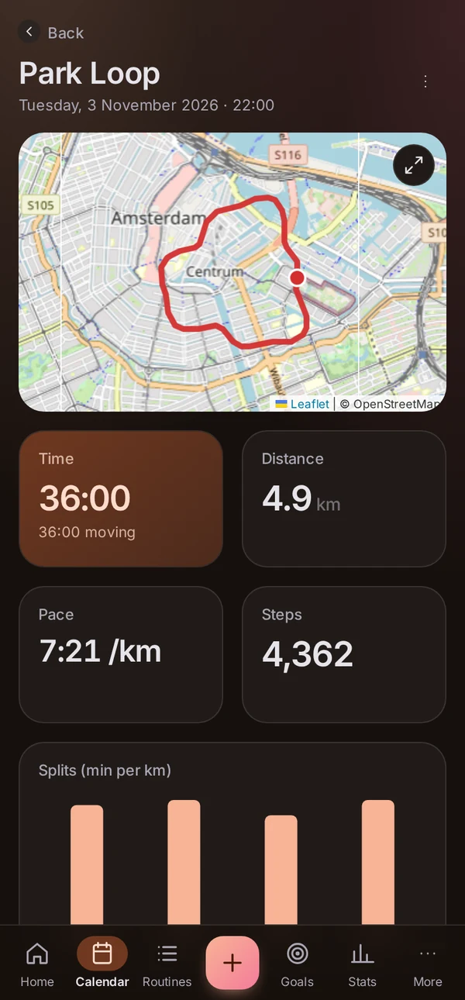
  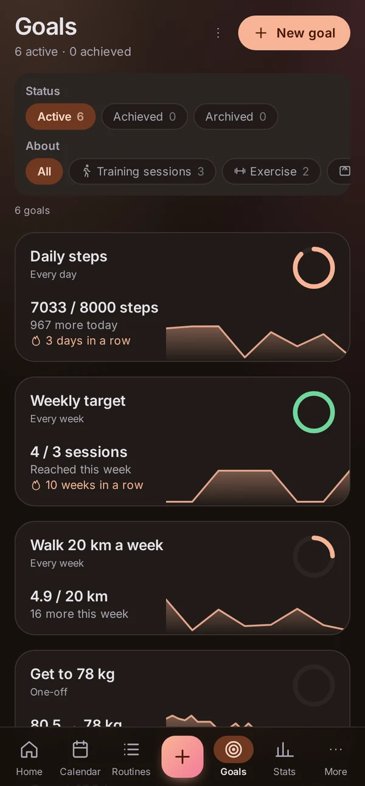
</p>

Make it yours: 18 colour sets or one built from any colour you pick, light or dark, and 10 backgrounds, plus corners,
density and fonts in the Appearance panel.

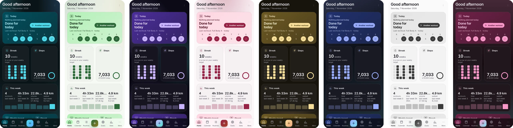

## Install

Pick the way that fits you. All of them run the same app.

| | What you get | Where your data lives |
|---|---|---|
| [**Android app**](#android) | The full app, with a lock-screen rest timer, GPS recording with the screen off and built-in updates | On the phone, or on your server |
| [**Desktop app**](#windows-and-linux) (Windows, Linux) | The full app in its own window, with built-in updates | On the computer, or on your server |
| [**Your own server**](#your-own-server-docker) (Docker) | A web app for every device and browser, installable as a PWA, with accounts for your family or friends | On your server |

The apps can do both at once: keep a **local account** that never leaves the device and a **server account** that syncs,
and switch between them in Settings → Servers & accounts. Server accounts keep working offline and sync when the server can be reached.

### Android

1. Download `motus-x.y.z.apk` from the [latest release](https://github.com/userofit123/motus/releases/latest) on your phone.
2. Open it and allow "Install unknown apps" for your browser or file manager when Android asks.
3. Choose **On this phone** to start right away, or enter your server's address to sign in.

Updates: Motus checks GitHub and offers new versions in Settings → App & Versions.
You can also follow the releases with [Obtainium](https://github.com/ImranR98/Obtainium).

### Windows and Linux

From the [latest release](https://github.com/userofit123/motus/releases/latest):

- **Windows:** `Motus-Setup-x.y.z.exe`
- **Linux:** `Motus-x.y.z.AppImage` (any distribution), `.deb` (Debian, Ubuntu) or `.rpm` (Fedora, openSUSE)

A local account on the desktop runs the Motus server inside the app, so nothing else is needed. Updates download in the
background and install when you press Install or restart the app.

### Your own server (Docker)

Motus is two containers: PostgreSQL and the Motus image (`ghcr.io/userofit123/motus`, amd64 and arm64).

```sh
mkdir motus && cd motus
curl -O https://raw.githubusercontent.com/userofit123/motus/main/docker-compose.yml
curl -o .env https://raw.githubusercontent.com/userofit123/motus/main/.env.example
# edit .env: set DB_PASSWORD to a long random password
docker compose up -d
```

Motus listens on `127.0.0.1:8790`. Put a reverse proxy with HTTPS in front, for example Caddy:

```
motus.example.com {
	reverse_proxy 127.0.0.1:8790
}
```

Open the address and create the first account: it becomes the admin. Invite others from Settings → Server admin.
Every person's data is kept apart by the database itself (row-level security), and admins cannot see anyone's workouts.

- **Update:** `docker compose pull && docker compose up -d`, or automatically every night with
  `docker compose -f docker-compose.yml -f docker-compose.autoupdate.yml up -d`.
- **Pin a version:** `MOTUS_VERSION=0.1.10` in `.env`.
- **Without Docker** and backups of the whole server: see [docs/self-hosting.md](docs/self-hosting.md).

## How it is built

| Part | What it is |
|---|---|
| `packages/engine` | All data logic and SQL migrations. Runs on PostgreSQL on the server and on PGlite (PostgreSQL in WebAssembly) inside the apps |
| `packages/shared` | Types and pure logic: units, training maths, settings, templates |
| `apps/server` | Fastify around the engine: sign-in, sessions, admin, live updates (SSE), media |
| `apps/web` | Vue 3 + TypeScript interface with a desktop layout and a phone layout |
| `apps/desktop` | Electron |
| `apps/android` | Capacitor, with native step counting, GPS and notifications |

Every change on one device shows up live on the others. More detail: [STATUS.md](STATUS.md) (what is built and what is planned),
[PLAN.md](PLAN.md) (design) and [docs/development.md](docs/development.md) (working on Motus).

## Development

```sh
docker compose -f docker-compose.dev.yml up -d    # web app with hot reload at http://127.0.0.1:8790
./scripts/pnpm.sh --filter @motus/engine test     # engine tests, including the data-isolation tests
```

See [docs/development.md](docs/development.md) for the full setup. Releases are published by GitHub Actions when a new
version lands in [CHANGELOG.md](CHANGELOG.md) on `main`.

## License

Motus is free to use, change and share for non-commercial purposes. Commercial use is not allowed.
See [LICENSE](LICENSE) (PolyForm Noncommercial 1.0.0).

The exercise library comes from [free-exercise-db](https://github.com/yuhonas/free-exercise-db) (public domain).
